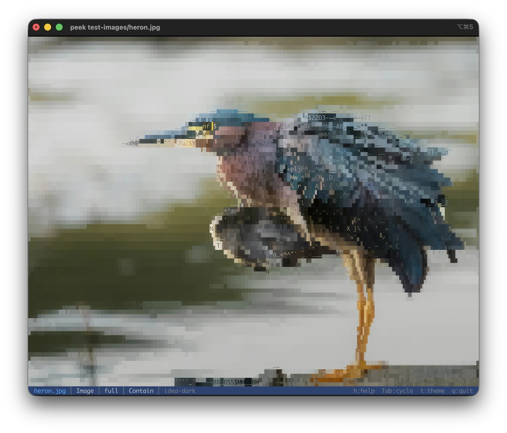
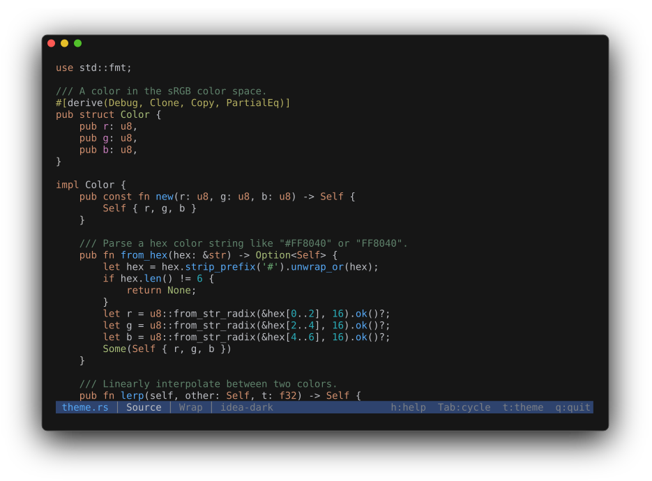
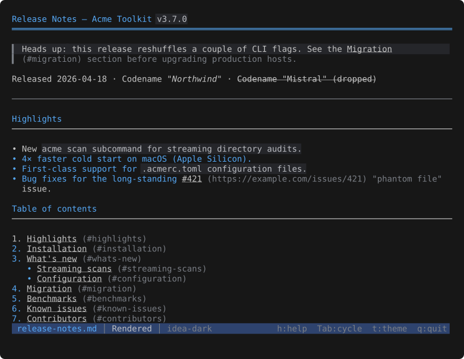
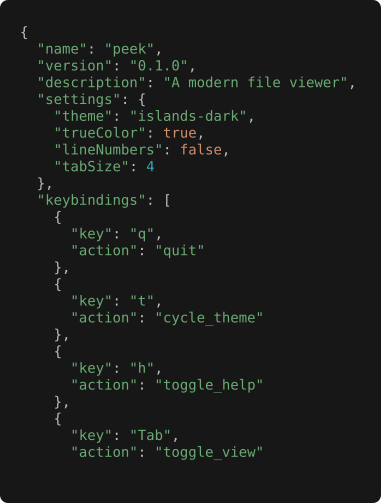
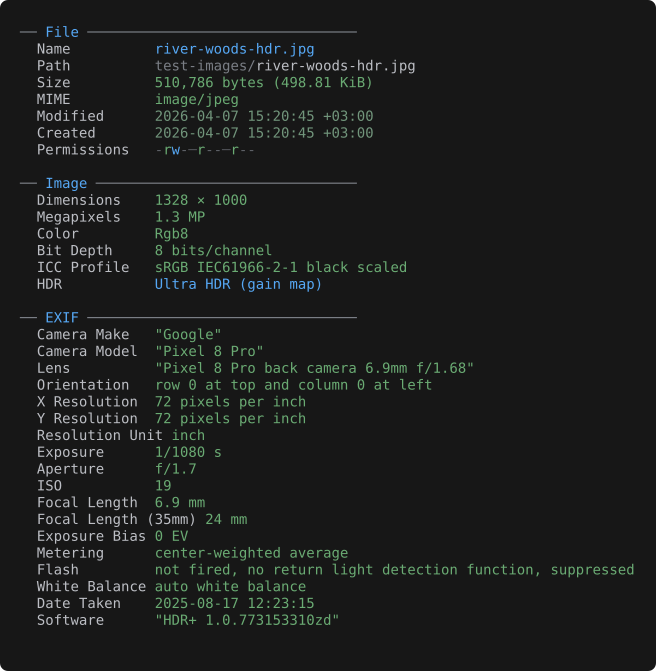
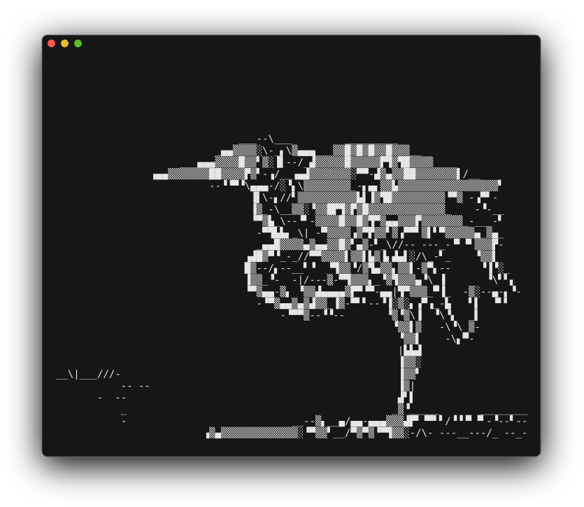
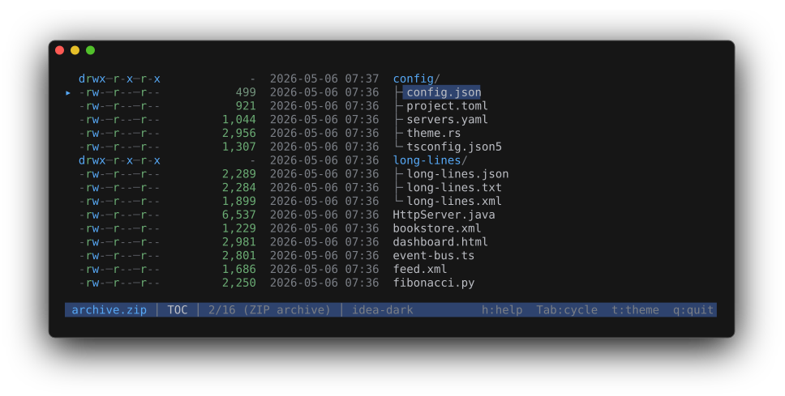

# peek

```
                 __
   ___  ___ ___ / /__
  / _ \/ -_) -_)  '_/
 / .__/\__/\__/_/\_\
/_/ a file previewer
```

peek is a modern terminal file viewer. It previews any file in any format.

**[Browse the manual](https://thaapasa.github.io/peek/)** for details on each format, keyboard
shortcuts, extraction, themes, and the full command-line reference.

<p align="center">
  <br>
  <sub>Glyph-matched 24-bit image rendering: a real photo, drawn with characters.</sub>
</p>

<p align="center">
  
  
  
</p>

- **Syntax highlighting.** peek highlights more than 100 languages with syntect.
- **Pretty-printing.** peek pretty-prints JSON, YAML, TOML, and XML.
- **Aligned tables.** peek shows CSV and TSV files as aligned tables with a sticky header and type
  inference. A streaming record reader handles large files.
- **SQLite databases.** peek lists the schema read-only and shows rows in a streaming viewer with a
  sliding-window cursor.
- **LMDB databases.** peek reads 0.9 and 1.0 environments. It lists the databases, streams key and
  value rows, and opens any value as its own file.
- **Spreadsheets.** peek reads `.xlsx`, `.xlsm`, and `.ods` files. It lists the sheets and shows
  each sheet as an aligned table. You can extract a sheet as CSV and see the workbook metadata.
- **Presentations.** peek shows the text of `.pptx`, `.pptm`, `.ppsx`, and `.odp` files slide by
  slide. Press `n` and `p` to step through the slides. Search works within each slide. For Apple
  Keynote (`.key`) files, peek shows the embedded preview and the metadata.
- **ASCII-art image rendering.** peek renders images with glyph-matched 24-bit color. Animated GIFs
  work too.
- **Documents.** peek reads Markdown, Jupyter notebooks (`.ipynb`), PDF, Adobe Illustrator (`.ai`),
  DOCX, ODT, RTF, EPUB, and CBZ. PDF pages render as images. An optional reconstructed-text overlay
  (`o`) writes the real text over the pixels at a matching zoom.
- **Email.** peek reads `.eml` messages and `.mbox` mailboxes. It renders the headers and the body,
  lists the attachments, and extracts them. You can drill into a message from the message list.
- **Calendars and contacts.** peek renders iCalendar (`.ics`) files as agenda cards and vCard
  (`.vcf`) files as contact cards. The cards show human-readable dates and times, grouped fields,
  and recurrence.
- **Vector and PostScript.** peek reads EPS and PostScript files (`.eps`, `.ps`). It shows the
  embedded preview, an optional Ghostscript render, and the Document Structuring Conventions (DSC)
  metadata.
- **Containers.** peek lists ZIP, tar, 7z, cpio, and ar archives and ISO disk images. It also shows
  audio metadata.
- **Executables.** peek reads ELF, Mach-O, PE, and WebAssembly (`.wasm`) object files. It shows the
  header, the sections, and the symbols.
- **Java classfiles.** peek shows the header, the fields, and the methods of a `.class` file, with
  decoded signatures.
- **Certificates and keys.** peek reads PEM and DER X.509 certificates, certificate signing requests
  (CSRs), certificate revocation lists (CRLs), keys, OpenSSH public keys, and JSON Web Keys (JWKs).
  It shows the subject, validity, subject alternative names (SANs), fingerprints, and thumbprints.
- **Fonts.** peek reads TrueType, OpenType, TrueType Collection (TTC), WOFF, and WOFF2 fonts. It
  renders a rasterized specimen and shows the family, weight, glyphs, and script coverage.
- **`.DS_Store`.** peek decodes the Apple Finder per-folder store into a table of records. The
  records hold icon positions, window geometry, view style, background, and modification dates.
- **Hex dump.** peek falls back to a hex dump for binary files. To open the hex dump from any view,
  press `x`.
- **Interactive viewer.** The viewer has live theme cycling, an info screen, extraction, text
  search, soft wrap, and image zoom and pan. Search takes literal text or a regular expression.

peek is a single-file viewer. It reads one path, or stdin, at a time. To view several files, run
peek once for each file.

## Install

On macOS or Linux, run:

```sh
curl -fsSL https://raw.githubusercontent.com/thaapasa/peek/main/install.sh | sh
```

The script installs the newest release into `~/.local/bin`. It supports `aarch64` and `x86_64`. To
pin a version, set `PEEK_VERSION=v0.1.0`. To install somewhere else, set
`PEEK_INSTALL_DIR=/usr/local/bin`.

To set up shell completions, add `eval "$(peek --completions zsh)"` to your shell startup file. For
bash, use `bash` in place of `zsh`. For fish, add `peek --completions fish | source`.

For manual downloads, Windows, building from source, updating, and completions, see the
[Installation chapter](https://thaapasa.github.io/peek/installation.html) of the manual.

## Usage

When you point peek at a file, it picks the view. The view can be a source highlight, an image
render, a structured pretty-print, a paged document, or a container listing:

```sh
peek src/main.rs                    # source code, syntax highlighted
peek photo.jpg                      # image rendered as glyph-matched art
peek config.json                    # structured data, pretty-printed
peek book.epub                      # paged read with TOC + metadata
peek server.pem                     # certificate — subject, validity, SANs, fingerprints
```

The file types are only half the tool. The same binary also runs **operations** on those files.

### Inspect metadata

peek shows metadata in human-readable form, or as JSON for pipelines:

```sh
peek server.pem --info              # subject, issuer, validity, key type, SANs
peek photo.jpg --info --json | jq .image.width
```

<p align="center">
  <br>
  <sub><code>peek photo.jpg --info</code> shows File, Image, and a detailed EXIF section.</sub>
</p>

### Re-render images

The `contour` mode draws Sobel edge line art. The other modes are `full`, `block`, `geo`, and
`ascii`.

```sh
peek diagram.png -m contour
peek photo.jpg -m contour --edge-density 0.1   # denser edges
```

<p align="center">
  <br>
  <sub><code>peek photo.jpg -m contour</code> draws the photo as glyph edge line art.</sub>
</p>

### Browse and extract containers

List the entries, and then pull one out:

```sh
peek archive.tar.gz --list                      # entry keys you feed back to --extract
peek book.epub --list
peek archive.tar.gz -x src/main.rs -o main.rs   # pull one entry, rename on the way out
peek archive.tar.gz -x logo.png -o -            # raw bytes straight to stdout
```

<p align="center">
  <br>
  <sub>The interactive archive browser shows a nested entry tree that you can drill into.</sub>
</p>

### Force print mode

To skip the interactive viewer and write straight to stdout, use print mode. It works well in pipes:

```sh
peek config.json -p | grep version
echo '{"a":1}' | peek               # stdin auto-detected
```

### More formats

peek also reads executables, Java classfiles, fonts, calendars, vCards, `.DS_Store`, and more. For
the full list, see the manual.

To see the short option list, run `peek -h`. To see the full set, run `peek --help`. The
[manual](https://thaapasa.github.io/peek/) covers each format in detail, along with keyboard
shortcuts, extraction, themes, and the full command-line reference.

## Manual

The full user manual is at **<https://thaapasa.github.io/peek/>**. peek also embeds the same manual.
`peek --manual` opens it in the terminal, and it matches the installed version.

The sources are in [`manual/`](manual/), built with [mdbook](https://rust-lang.github.io/mdBook/).
To preview the manual locally, run:

```sh
mise run manual    # serves http://localhost:12620
```

## Development

[mise](https://mise.jdx.dev/) installs the tools for building, linting, and the manual. This
includes the Rust toolchain pinned in `rust-toolchain.toml`. x86 builds also need `nasm`.

```sh
mise install        # Rust, nightly rustfmt, node, prettier, mdbook
mise run setup      # opt-in: fuzzing, cargo-audit, demo capture (mise.dev.toml)
mise run lint
mise run test
mise run format     # Rust (nightly rustfmt) + Markdown (Prettier)
```

## Credits

Demo photo by
[Dmytro Koplyk on Unsplash](https://unsplash.com/photos/a-green-heron-stands-on-one-leg-by-the-water-LHZgiiQz97o).
For full attribution of all bundled sample files, see [CREDITS.md](CREDITS.md).

To regenerate the screenshots from the repository fixtures, run `mise run demos`. `mise run setup`
installs the tools it needs.

## License

MIT
