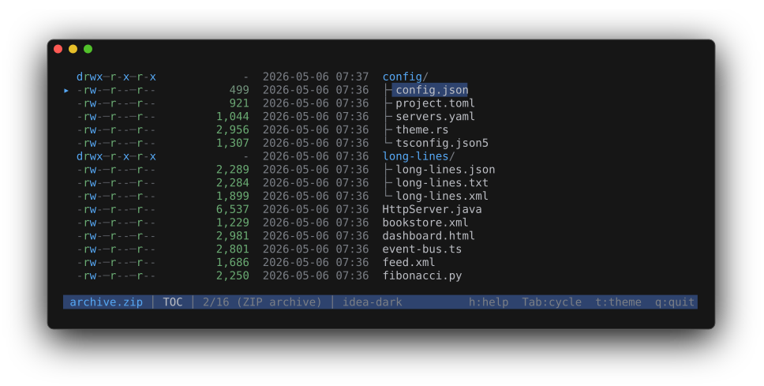

# Archives

Container archives open in a **TOC view**, short for table of contents. The view has one row per
entry, with permissions, uncompressed size, modification time, and path. To build the listing, peek
reads only the header of each entry, so multi-GB archives open instantly.

<!-- peek-skip -->

_The interactive TOC browser shows the entries as a nested tree, with `├╴` and `└╴` marking the
children of each directory. Each row shows permissions, size, and modification time. Move the cursor
to an entry to descend into it and preview it, or to extract it._

<!-- /peek-skip -->

| Format       | Extensions                     | Spec                                                                               |
| ------------ | ------------------------------ | ---------------------------------------------------------------------------------- |
| ZIP          | `.zip`, `.jar`, `.war`, `.apk` | [PKWARE APPNOTE](https://pkware.cachefly.net/webdocs/casestudies/APPNOTE.TXT)      |
| Tar          | `.tar`                         | [POSIX ustar](https://pubs.opengroup.org/onlinepubs/9699919799/utilities/pax.html) |
| Tar + gzip   | `.tar.gz`, `.tgz`              |                                                                                    |
| Tar + bzip2  | `.tar.bz2`, `.tbz2`            |                                                                                    |
| Tar + xz     | `.tar.xz`, `.txz`              |                                                                                    |
| Tar + zstd   | `.tar.zst`, `.tzst`            |                                                                                    |
| Tar + lz4    | `.tar.lz4`, `.tlz4`            |                                                                                    |
| Tar + brotli | `.tar.br`, `.tbr`              |                                                                                    |
| 7-Zip        | `.7z`                          | [7-Zip format](https://www.7-zip.org/7z.html)                                      |
| cpio         | `.cpio`, `.cpio.gz`            | newc and ODC headers. Old binary headers not supported.                            |
| ar, Debian   | `.ar`, `.deb`, `.a`            | Unix `ar(1)` archive, also used for Debian binary packages                         |

## Navigation

The regular [scroll keys](../keyboard-shortcuts.md#navigation) move a cursor that selects files and
skips directories. The selected file gets a highlighted background and an arrow marker. The top and
bottom keys jump to the first and last file. The paging keys scroll a screenful and move the
selection to the first visible file.

When you scroll, a **sticky parent breadcrumb** pins the parent directories of the top row to the
top of the viewport. To turn the breadcrumb on or off, press `s`.

To descend into the selected entry, press `Enter`. This is a recursive peek: peek opens the entry
through the full peek pipeline, as if it were a standalone file. To extract the entry, press `e`.
For details, see [Extraction](../viewer/extraction.md).

## Info view

The Info view shows the entry count, file count, directory count, and total uncompressed size. If
peek can't list the archive, for example because it's corrupt or an unsupported variant, the view
shows a warning row.

Some `ar` archives are **static libraries** (`.a` or `.lib`), whose members are object files. For
these, the Info view adds a Static library section with the number of object members and the target
architecture. An `ar` archive whose members aren't object files, such as a `.deb`, doesn't show this
section.

## Single-stream compression

A file compressed with a single codec, without a tar archive inside, decompresses transparently.
peek opens the inner content directly and shows it as whatever it is, such as source code, JSON, or
an image. The Info view adds a Compression row with the codec and the sizes before and after
decompression.

| Format | Extension |
| ------ | --------- |
| gzip   | `.gz`     |
| bzip2  | `.bz2`    |
| xz     | `.xz`     |
| zstd   | `.zst`    |
| lz4    | `.lz4`    |
| brotli | `.br`     |

peek has no fixed limit on the decompressed size. To limit memory use, peek writes output larger
than 16 MiB to a temporary file. If the output grows past 8 GiB, which suggests a decompression
bomb, peek shows a warning. It does the same for a corrupt or truncated stream. In both cases, the
viewer falls back to a hex view of the raw compressed bytes.

peek detects every format here by its magic bytes, except brotli. A raw brotli stream has no
signature, so peek recognizes `.br` and `.tar.br` files by their extension only. If you pipe a
brotli stream through stdin without a filename, peek doesn't detect it.
