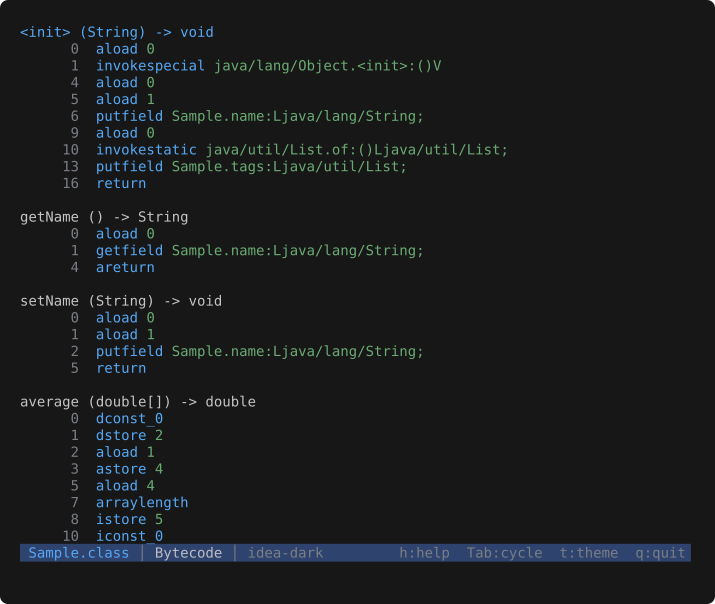

# Java classfiles

Compiled Java classes, or `.class` files, open in a dedicated viewer instead of the hex view that
peek uses for other binary files. peek detects classfiles by their magic bytes, so it recognizes a
classfile even without the `.class` extension.

## Views

To cycle through the four views, press Tab:

- **Info**: the class header. It shows the class name, the superclass, the implemented interfaces,
  the JDK version, and the kind: class, interface, or enum. It also shows the source file that the
  class was compiled from and the number of fields and methods.
- **Fields**: a table of every field, with its modifiers, type, and name.
- **Methods**: a table of every method, with its modifiers, name, and signature. peek decodes the
  type descriptors to source form. For example, it shows `(String, int) -> int` instead of the raw
  `(Ljava/lang/String;I)I`.
- **Bytecode**: a disassembly of every method in the style of `javap -c`. Each instruction shows its
  byte offset, mnemonic, and operand. peek resolves method and field references and shows simple
  branch targets as absolute offsets. For `tableswitch` and `lookupswitch`, it shows the number of
  entries. To jump to the next method, press `n`. To jump to the previous method, press `p`. To
  search the listing, press `/`.

The Fields and Methods tables work like the object file tables. They have a pinned column header,
and you can pan through the columns with `Left` and `Right` and search with `/`.

## Limitations

Fields and methods are views, not files that you can extract. For this reason, the `e` extract key
doesn't work here.
