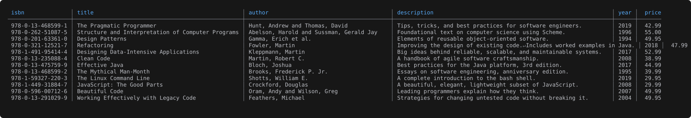

# CSV and TSV

| Format | Extensions |
| ------ | ---------- |
| CSV    | `.csv`     |
| TSV    | `.tsv`     |

peek shows CSV and TSV files as an **aligned table**. The header row stays at the top, and the body
rows scroll underneath it. peek pads each column to a common width.

<!-- peek-skip -->

_peek measures the columns and pads each one to a common width. Numeric columns align to the right.
The header stays pinned as you scroll the body._

<!-- /peek-skip -->

## View modes

- **Table**: the default. Shows aligned columns with a sticky header.
- **Source**: shows the raw bytes in the text viewer.
- **Info**: shows the inferred type of each column, the record count, and a count of malformed
  records.

To cycle between the modes, press Tab. To open the hex view, press `x`. To show the help screen,
press `h` or `?`.

## Column widths

When you open a file, peek sets the column widths from the first 1000 records. As you scroll,
columns only grow. When a wider cell scrolls into view, its column widens once and keeps the new
width. The sticky header repaints with the new layout, so the column titles stay aligned with the
body. Columns never shrink on their own.

To shrink the columns, press `Shift+R`. peek then recalculates the widths from the records visible
in the viewport. One deliberate key press is better than columns that keep changing width as you
scroll.

If a cell is wider than its column, peek truncates it with an ellipsis (`…`). To see the full value,
use the Source view.

## Column alignment

If a column holds only integers and floating-point numbers in the first 1000 records, it aligns to
the right so that the digits line up. All other columns align to the left. peek infers the alignment
once from those records and keeps it for the whole session. If you toggle the header, the data
alignment doesn't change.

## Multi-line cells

A CSV record can contain a newline (`\n`) inside a quoted cell. peek shows each such cell on a
single row and replaces the newline with a muted `↵` marker. Tabs become spaces, and peek drops
carriage returns. This way, these characters can't move the terminal cursor or push the next columns
onto the next row.

## Header detection

peek treats row 0 as a header if every cell in it looks like text. A cell looks like text if it
isn't an integer, a floating-point number, a Boolean, or an ISO date. If any cell in row 0 has one
of these types, peek treats row 0 as data, not as a row of labels.

To turn the header on or off, press `Shift+H`. This overrides the detection. When the header is off,
row 0 is part of the body and the sticky header area is empty.

## Horizontal pan

If the table is wider than the terminal, `Left` and `Right` move one column at a time. The sticky
header moves together with the body. The status bar shows `col N/total`.

## Delimiter detection

The default delimiter is a comma for `.csv` files and a tab for `.tsv` files. peek also checks the
first 64 KiB for commas, tabs, semicolons, and vertical bars (`,`, `\t`, `;`, and `|`). If another
delimiter occurs more than 3 times as often as the default outside quoted text, peek uses it
instead. This handles files with the wrong extension.

## Encoding

peek reads UTF-8 directly. It detects UTF-16 LE and UTF-16 BE files by their byte order mark (BOM)
and converts them to UTF-8 as it reads them. Unlike UTF-8 files, which peek streams, the conversion
holds the whole file in memory. For this reason, peek converts UTF-16 files of up to 32 MB only. A
larger UTF-16 file opens in the Source view only, and a warning explains why the table view is
missing.

## Malformed records

peek treats a record as malformed if it's larger than 4 MiB or spans more than 10 000 lines in the
file. This limit protects against quoted strings that never end. Records that the `csv` crate
rejects also count as malformed. Examples are a wrong number of columns, bad quoting, and invalid
UTF-8.

peek shows a malformed record as a single `<error>` cell in the theme's warning color. The status
bar shows how many malformed records peek has found so far.

## Search

To search, press `/`. Each match must fit inside a single cell, so a query that spans the comma
between two columns finds nothing. The search finds substrings and uses smart case:

- If the query is all lowercase, the search ignores case.
- If the query has any uppercase letters, the search matches case.

The search covers rows that peek hasn't loaded yet. peek reads through the records without loading
them all into memory. To keep a multi-gigabyte CSV from freezing the viewer, peek scans at most 256
MB of record data for each query. If the scan reaches this limit, peek marks the counts as partial,
such as `12/3400+` or `no match (partial scan)`, and shows a warning.

To step through the matches, press `n` for the next match and `p` for the previous one. The search
wraps around at the ends. The viewport scrolls and pans so that the cell with the match is in view.
To clear the search, press `Esc`.

## Print mode

If you run `peek --print foo.csv` or pipe the output into another tool, peek writes the table to
standard output (stdout). It uses only the widths that it measured from the first 1000 records, and
columns don't widen. If a cell is wider than its column, peek prints the full cell and the rest of
that row moves to the right, past the edge of the terminal. The terminal cuts off the row at its
edge. The next row is aligned again.
