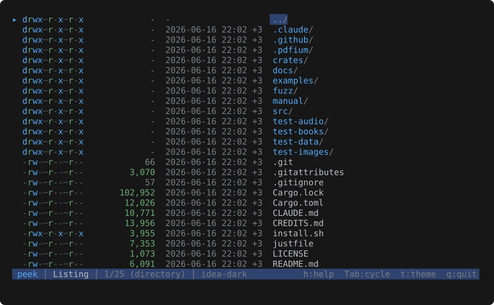

# Directories

When you run `peek <dir>`, peek opens a listing of that one directory level. It doesn't fail with an
`is a directory` error. The columns match the archive TOC view: permissions, size, modification
time, and name.

<!-- peek-skip -->

_Browsing the project root. Directories come first, with a trailing `/`, and then files. A synthetic
`..` row lets you walk back up. To descend into the selected entry, press `Enter`._

<!-- /peek-skip -->

peek lists directories first and then files. Within each group, peek sorts by name and ignores case.

A synthetic `..` row at the top of the list lets you walk back up. peek leaves it out at the file
system root. When you select `..`, peek resolves the canonical form of the current path and opens
its parent. The cursor then lands on the subdirectory you came from, not at the top of the list.
This way, when you step in and out of sibling directories, you stay where you were.

| Key         | Action                                                                                          |
| ----------- | ----------------------------------------------------------------------------------------------- |
| `Enter`     | Open the selected entry. A file opens in a new frame. A directory replaces the current listing. |
| `Backspace` | Go up to the parent directory. The cursor lands on the directory you came from.                 |
| `Esc`       | In a directory listing, exit peek.                                                              |

The listing includes hidden entries. peek follows symbolic links to find the kind of the target. A
broken symbolic link still shows as `l`. Other special files, such as sockets, FIFOs, and devices,
show as `?`.

Both `--print` and `--list` render the listing.
