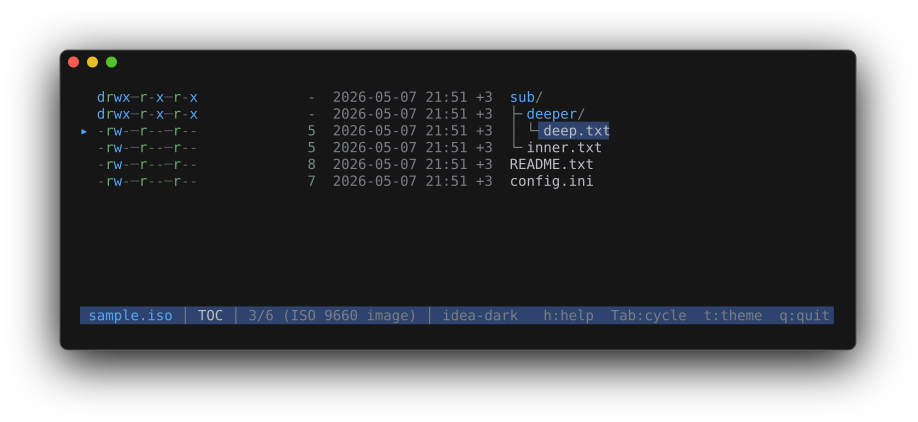

# Disk images

| Format | Extension             | Spec                                                                         |
| ------ | --------------------- | ---------------------------------------------------------------------------- |
| ISO    | `.iso`                | [ISO 9660](https://en.wikipedia.org/wiki/ISO_9660) plus Joliet and El Torito |
| DMG    | `.dmg`                | [Apple Disk Image, UDIF](https://en.wikipedia.org/wiki/Apple_Disk_Image)     |
| Raw    | `.img`, `.bin`, `.dd` | Master Boot Record (MBR) partition table, no known file system header        |

peek has its own parsers for both ISO and DMG, so it needs no extra crate. The hex view (`x`) works
on the raw image bytes for every format.

## ISO

An ISO image opens in a table of contents (TOC) view. Each file or directory has one row with its
size, modification time, and 8.3 or Joliet name. Indented tree glyphs show the depth.

peek reads the root directory extent from the Primary Volume Descriptor (PVD) and recurses through
the child extents. When the image has Joliet extensions, peek reads the Supplementary Volume
Descriptor (SVD) instead, because it holds longer Unicode names. Limits on depth and entry count
protect against malformed images.

<!-- peek-skip -->



_The ISO browser is the same interactive TOC browser that archives use. This example shows a
multi-level tree (`sub/ ├╴deeper/ │ └╴deep.txt`) read straight from the ISO 9660 directory extents._

<!-- /peek-skip -->

peek doesn't show permissions for each entry, because it doesn't parse the Rock Ridge System Use
Sharing Protocol (SUSP) data. Directories show `rwxr-xr-x` and files show `rw-r--r--` as defaults.

To extract an entry, use `--extract <path>` or press `e` in the viewer. ISO extraction is zero-copy.
It reads a `FileRange` view over the image file. It doesn't decompress or buffer anything.

The Info view shows the following:

- The `Volume`, `Volume set`, `System`, `Publisher`, `Data preparer`, and `Application` fields.
- Volume size in blocks.
- The four PVD timestamps: creation, modification, expiration, and effective.
- Whether the image has Joliet and El Torito extensions.

## DMG

A DMG image opens straight on the file info screen. peek doesn't list the files, because the inner
file system (HFS+, APFS, or FAT) would need its own walker.

The Info view parses the 512-byte `koly` trailer at the end of the file. It shows the following
fields:

- Universal Disk Image Format (UDIF) version.
- Image variant: device, partition, or mounted system.
- Total uncompressed size and data fork length.
- Size of the embedded XML partition map.
- Segment number and segment count.
- Data and master checksum algorithms.
- The documented trailer flag bits: flattened and internet-enabled.

The Info view also decodes the **partition map** from the embedded property list. This takes one
small read and no payload bytes. Each real file system, such as `Apple_HFS` or `Apple_APFS`, gets
its own detail block. The format scaffolding collapses into one `Partition scheme` block with one
line for each item. The scaffolding includes these items:

- The protective MBR.
- The primary and backup GUID Partition Table (GPT) headers and tables.
- Free-space gaps.

peek hides nothing. The split only puts the real content first.

Each row shows its image offset. This is the byte position that you'd pass to `mount -o offset=`,
`dd skip=`, or `mmls`. For example:

```
Partitions    8 (1 filesystem, 7 scheme)

── Partition · HFS+ ───────────────────
  Name          disk image (Apple_HFS : 4)
  Type          HFS+ (Apple_HFS)
  Logical size  596.33 MiB
  Stored        159.64 MiB (27% of logical)
  Compression   zlib · 3.7×
  Chunks        408 (1 raw, 4 ignore, 403 zlib)
  Image offset  20,480 B (sector 40)

── Partition scheme ────────────────────
  MBR                512 B · zlib · @ 0 B
  Primary GPT Header 512 B · zlib · @ 512 B
  free space         3.00 KiB · sparse · @ 17,408 B
  ...
```

peek doesn't walk the inner file system of each partition (HFS+ or APFS). That's a separate effort
for later. peek reads the compression runs only for their structure and doesn't decompress them. You
also can't extract from a DMG image.

## Raw

The raw format covers generic disk images (`.img`, `.bin`, and `.dd`) that don't match a known file
system header. If the image has an MBR partition table, the Info view parses it and shows the
partition type, boot flag, logical block address (LBA) offset, and sector count. Otherwise it shows
a `raw image` label.

peek can't list the files in a raw image, because each file system type would need its own walker.
The hex view (`x`) works on the raw bytes.
