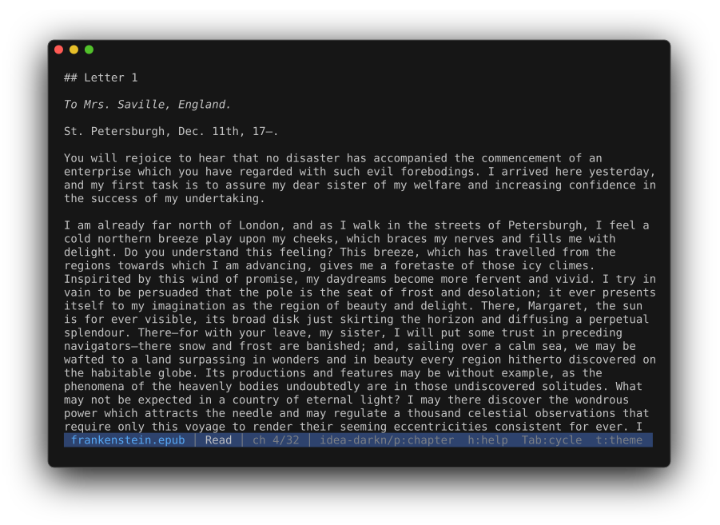

# Ebooks

| Format | Extension | Spec                                                                                          |
| ------ | --------- | --------------------------------------------------------------------------------------------- |
| EPUB   | `.epub`   | [EPUB 3](https://www.w3.org/TR/epub-33/), a ZIP container with HTML chapters and OPF metadata |

## EPUB

An EPUB file has three views. To cycle through them, press `Tab`.

- **Read** (default): shows one chapter at a time through the shared HTML rendering pipeline. It
  uses the same `html2text` driver as the standalone [HTML viewer](./html.md).
  - To step forward or back through the spine, press `n` or `p`. The status line shows `ch X/Y`.
  - peek caches each rendered chapter at the current width, so stepping back is instant. When you
    resize the terminal, peek renders only the visible chapter again.
  - If an `` tag has an empty or missing `alt`, peek shows the fallback label
    `image: <basename>`.
  - A cover-style chapter has almost no text and at least one image. peek renders its first image
    inline as ASCII, so `peek book.epub` opens on the cover.
- **TOC**: shows the raw ZIP file tree. Use it to inspect cover images, stylesheets, or the OPF and
  NCX metadata files. To open the selected entry in a recursive peek, press `Enter`.
- **Info**: shows the Dublin Core metadata from the OPF file. This includes the title, author
  (`dc:creator`), language, publisher, date, identifier, and description, plus the spine length.

In print mode, peek writes every chapter in spine order, with blank lines between them. This means
that `peek book.epub | less` shows the whole book.

peek doesn't support other ebook containers yet, such as MOBI, AZW3, or FB2.
