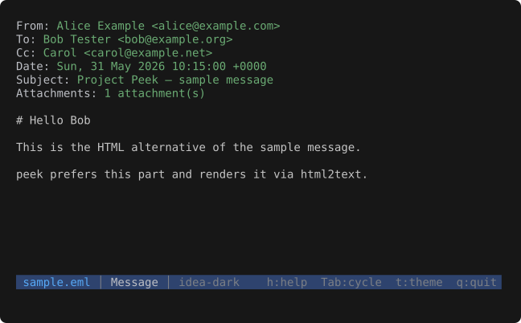

# Email

| Format  | Extension | Notes                                                       |
| ------- | --------- | ----------------------------------------------------------- |
| Message | `.eml`    | A single RFC 822 or MIME message                            |
| Mailbox | `.mbox`   | Many messages concatenated, each preceded by a `From ` line |

peek parses both formats with the pure-Rust `mail-parser` crate. peek also recognizes a message by
its content. A file without an extension still opens as email when it starts with a `From `
separator (mbox) or an RFC 822 header block.

## Single messages (`.eml`)

To cycle through the views, press Tab:

- **Message** is the default view. It shows a header block followed by the body. The header block
  contains From, To, Cc, Date, and Subject. When the message has attachments, the header block also
  shows the attachment count. HTML messages render through the same `html2text` driver as the
  [HTML viewer](./html.md). peek wraps plain-text messages to the terminal width.
- **Source** shows the raw RFC 822 text. To skip the rendered view and open straight on the source,
  use `--plain`.
- **Attachments** appears only when the message has attachments. It shows one row for each MIME
  attachment. Each row shows the MIME type and size of the attachment. To
  [extract](../viewer/extraction.md) the selected attachment to disk, press `e`. To open it with a
  recursive peek, press `Enter`.
- **[Info](../viewer/info-screen.md)** shows the header summary. For details, see [Info](#info).

As with every file, press `x` to open the [hex dump](./binary.md), and press `h` or `?` to open the
help screen.

<!-- peek-skip -->

_The default Message view shows the header summary followed by the rendered body._

<!-- /peek-skip -->

## Mailboxes (`.mbox`)

A mailbox opens in a **Messages** list with one row for each message. Each row starts with the
message's position, so messages with the same subject stay distinct. Each row also shows the message
date.

To open a message, press `Enter`. The message opens with the same views as a standalone `.eml` file,
which are Message, Attachments, Info, hex, and help. The difference is that it has no raw **Source**
view of its own. Instead, the mailbox has a second top-level view with its own raw text.

peek reads the mailbox as a stream and parses only the message that you open. Because of this, even
a very large mailbox lists instantly.

## Info

For a `.eml` file, the Info view shows the header summary, the attachment count, and the total size.
For a `.mbox` file, it shows the message count.
