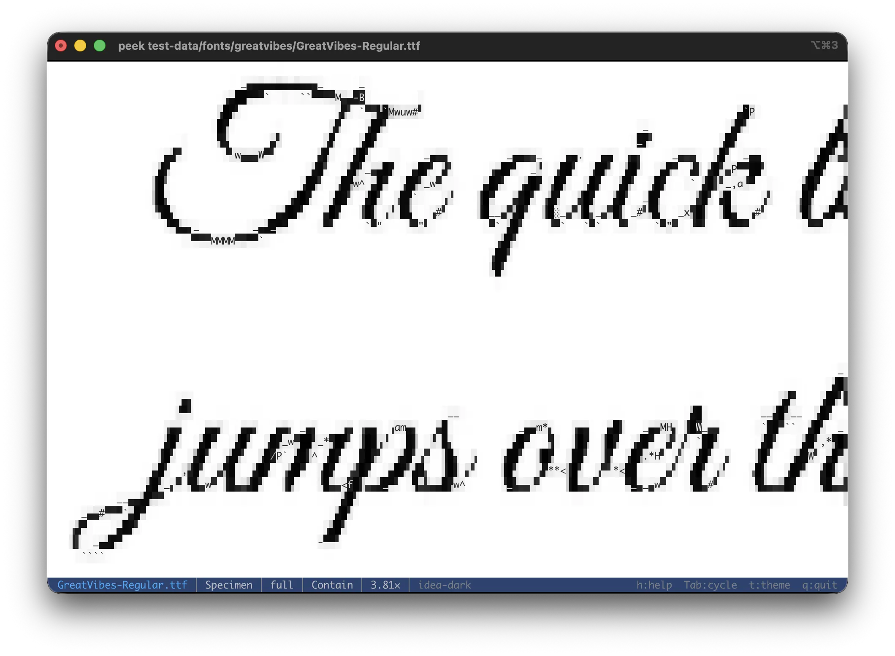

# Fonts

TrueType and OpenType font files open in a **specimen view**. This view rasterizes a sample sentence
through the font and renders it with peek's ASCII image pipeline. The **Info** section decodes every
standard OpenType metadata table.

```sh
peek Lobster-Regular.ttf
peek /System/Library/Fonts/Menlo.ttc
```

## Supported formats

| Extension         | Format                                                                  |
| ----------------- | ----------------------------------------------------------------------- |
| `.ttf`            | TrueType outline fonts                                                  |
| `.otf`            | OpenType outline fonts, including Compact Font Format (CFF) outlines    |
| `.ttc`, `.otc`    | TrueType and OpenType collections, which hold several faces in one file |
| `.woff`, `.woff2` | Web Open Font Format (WOFF) 1.0 and 2.0 web fonts                       |

peek unwraps a WOFF font to its inner font before it shows it.

## Detection

peek detects fonts in two ways:

- **By extension:** the extensions in the preceding table.
- **By content:** a 4-byte magic number at offset 0. The values are `00 01 00 00` for TrueType,
  `true` for the Apple TrueType variant, `OTTO` for OpenType with CFF outlines, and `ttcf` for a
  collection. Content detection also works for sources without a name, such as stdin and archive
  entries.

## Specimen view

When you open a font, peek shows a rasterized sample sentence. The sample is a fixed ASCII pangram
with digits, common punctuation, and a mixed-case alphabet line. This text is enough to show the
baseline, x-height, cap height, and descender shapes.



Every image-mode key works on the specimen:

| Key | Action                                                              |
| --- | ------------------------------------------------------------------- |
| `m` | Cycle the image mode: `full`, `block`, `geo`, `ascii`, or `contour` |
| `b` | Cycle the background: auto, black, white, or checkerboard           |
| `f` | Cycle the fit mode: contain, fit width, or fit height               |

The zoom and pan keys also work on the specimen. For details, see
[Zoom and pan](../viewer/zoom-pan.md).

If peek can't rasterize a font, peek shows no specimen and opens the Info and Hex views instead. It
doesn't show an error.

## Font collections

In a `.ttc` or `.otc` file, press `n` or `p` to step the specimen to the next or previous face. The
status line shows `Face N/M` and updates as you cycle. The Info screen lists the metadata of each
face in a separate block. For example, the four-face Apple system font `Menlo.ttc` shows the
Regular, Bold, Italic, and Bold Italic variants on one screen.

## Info

For each face, the **Font** section shows the following:

- **Identity:** family, subfamily (such as `Regular`, `Bold`, or `Italic`), full name, PostScript
  name, and version.
- **OS/2 classification:** weight, width class (such as `Normal`, `Condensed`, or `Expanded`),
  italic flag, and monospaced pitch flag. The weight is a value from `100` to `900`, shown with its
  canonical name, such as `400 (Regular)` or `700 (Bold)`.
- **Geometry:** glyph count, and units per em, which is the resolution of the design grid.
- **Coverage:** the Unicode code point count, summed across every `cmap` subtable. The section also
  lists scripts, grouped from the `cmap` ranges: `Latin`, `Latin Extended`, `Greek`, `Cyrillic`,
  `Hebrew`, `Arabic`, `Devanagari`, `Thai`, `Hangul`, `CJK`, `Emoji`, and `Symbols`. The list shows
  which glyphs the font contains, not which scripts it claims to support.
- **Rendering hints:** a flag that shows whether the font has hinting. peek sets the flag when bit 0
  of `head.flags` is set.
- **Attribution:** designer, vendor URL, copyright, and license URL. peek skips each row when the
  `name` table doesn't contain the field.

Apple system fonts, such as Menlo and San Francisco, still store their canonical name records on the
Macintosh platform in the Mac Roman encoding. peek includes the full mapping for the upper half of
Mac Roman, so `©`, `™`, and accented Latin characters display correctly.

## What you don't see

- Fonts have no source view. A font is a binary container, so to inspect the raw bytes, use the hex
  view (`x`), which works for every file.
- The specimen sample is fixed ASCII text. A planned change picks samples in other scripts from the
  font's `cmap` coverage.
- In a `.ttc` file, you cycle faces in place in the specimen. You can't open a single face in its
  own viewer frame with a recursive peek. That needs peek to build a standalone `sfnt` font from the
  TTC table directory. This is a planned follow-up.
