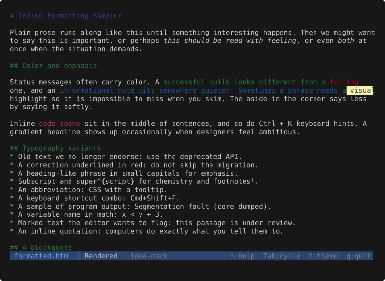

# HTML

peek gives HTML two views. This applies to `.html`, `.htm`, and `.xhtml` files, and to stdin streams
that start with `<!DOCTYPE html>` or `<html`. To switch between the views, press Tab.

- **Rendered** is the default view. It shows the page as flowing text in the style of Lynx, using
  the [html2text](https://crates.io/crates/html2text) crate. Paragraphs wrap to the terminal width,
  and the view shows list bullets, a grid for tables, and numbered link references. It uses ANSI
  styling for `<strong>`, `<em>`, `<code>`, `<s>`, and `<a>`. It also applies author colors from
  inline `style="..."` attributes and `<style>` rules. peek filters out author colors that are close
  to gray, so the body and heading defaults don't clash with the terminal foreground.
- **Source** shows the raw HTML with XML syntax highlighting.

<!-- peek-skip -->

_The default rendered view shows Lynx-style flowing text with paragraph wrap, list bullets, and ANSI
styling from author colors instead of raw tags._

<!-- /peek-skip -->

The Info view shows structured XML statistics, such as the root element and element counts.
