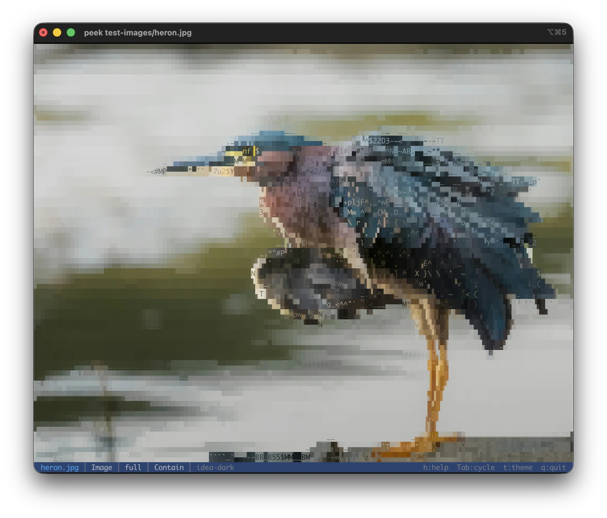
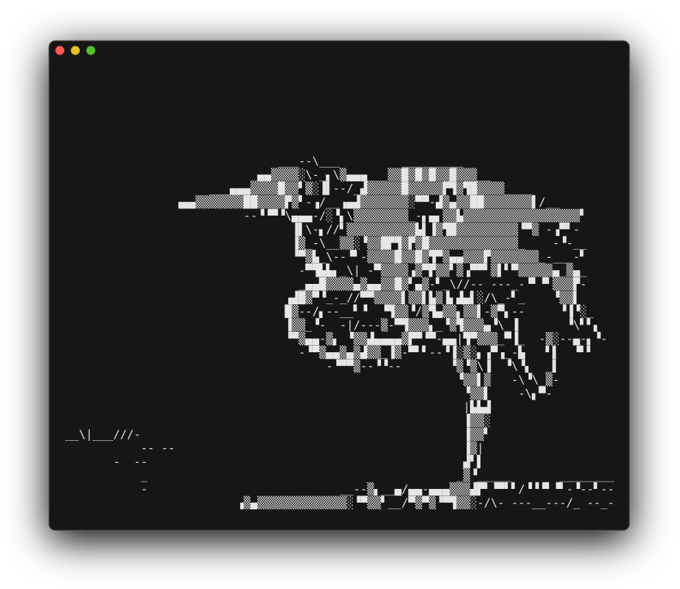

# Images

peek renders raster images as ASCII art in 24-bit color. For each character, it picks the glyph that
best matches the image.

_The default `full` mode: every terminal cell picks the glyph, foreground color, and background
color that best match the pixels beneath it._

| Format  | Extensions             |
| ------- | ---------------------- |
| PNG     | `.png`                 |
| JPEG    | `.jpg`, `.jpeg`        |
| GIF     | `.gif`                 |
| BMP     | `.bmp`                 |
| WebP    | `.webp`                |
| TIFF    | `.tiff`, `.tif`        |
| ICO     | `.ico`                 |
| AVIF    | `.avif`                |
| PNM     | `.pnm`, `.pbm`, `.pgm` |
| TGA     | `.tga`                 |
| OpenEXR | `.exr`                 |
| QOI     | `.qoi`                 |
| DDS     | `.dds`                 |

peek decodes images with the [image](https://crates.io/crates/image) crate. For AVIF, it uses
[avif-decode](https://crates.io/crates/avif-decode), which builds on the pure-Rust `rav1d` decoder.

## Render modes

To cycle through the render modes, press `m`. To pick one from the command line, use
`--image-mode <mode>`.

| Mode      | Description                                                          |
| --------- | -------------------------------------------------------------------- |
| `full`    | All glyphs: block, quadrant, and extended. This is the default.      |
| `block`   | Block and quadrant elements, plus a subset of ASCII                  |
| `geo`     | Block and quadrant elements, plus line segments only                 |
| `ascii`   | Legacy density ramp based on luminance, for terminals without blocks |
| `contour` | Sobel edge detection, rendered as line art                           |

To tune how many lines the `contour` mode draws, use `--edge-density`.

<!-- peek-skip -->

_The same photo in `contour` mode. It draws the Sobel edges as line art instead of filled color._

<!-- /peek-skip -->

## Backgrounds

An image with transparency needs a background to composite onto before peek renders it as ASCII art.
Without one, transparent regions turn black, and dark content becomes invisible on a dark terminal.

To cycle through the backgrounds, press `b`. To pick one from the command line, use
`--background <mode>`.

| Background     | Description                                                                                        |
| -------------- | -------------------------------------------------------------------------------------------------- |
| `auto`         | A white background for dark content and a black background for light content. This is the default. |
| `black`        | Solid black                                                                                        |
| `white`        | Solid white                                                                                        |
| `checkerboard` | An 8×8 gray checkerboard, like the one in Photoshop                                                |

## Fit modes

To cycle through the fit modes, press `f`.

| Mode        | Behavior                                                                                 |
| ----------- | ---------------------------------------------------------------------------------------- |
| `Contain`   | The image fits within both axes, so you see all of it. This is the default.              |
| `FitWidth`  | The image fills the terminal width. Its height grows freely, so you scroll vertically.   |
| `FitHeight` | The image fills the terminal height. Its width grows freely, so you scroll horizontally. |

Output to a pipe or with `--print` always uses `Contain`.

The regular [scroll keys](../keyboard-shortcuts.md#navigation) move along the axis that overflows.
In `FitWidth`, they scroll vertically. In `FitHeight`, they scroll horizontally. The keys that jump
to the top and bottom go to the top-left and bottom-right corners.

## Zoom

For the keys and how zoom works, see [Zoom and pan](../viewer/zoom-pan.md).

## Animated GIF and WebP

Animations play automatically at their native frame rate.

- To play or pause, press `Space`.
- To step to the next or previous frame, press `n` or `p`.
- To extract the current frame as a PNG, press `e`.

In print mode, peek renders the first frame. The file info screen shows the frame statistics.

## Info view

The Info view shows the dimensions, megapixels, color mode, bit depth, ICC profile, HDR detection,
animation statistics, EXIF, and XMP metadata. peek detects HDR from Ultra HDR gain map markers.

The EXIF section shows these fields:

- Camera make and model
- Lens
- Orientation
- Resolution and DPI
- Exposure, aperture, and ISO
- Focal length
- Flash
- White balance
- Date taken
- GPS
- Artist and copyright

peek reads XMP from the bytes at the start of the file. It shows the Dublin Core and XMP fields:
title, subject, description, creator, rights, rating, and label.
