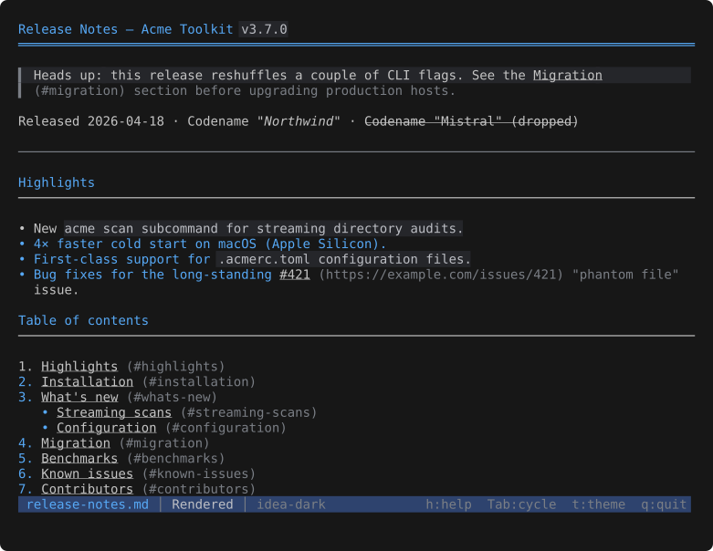

# Markdown

Like HTML and PDF files, Markdown files have two views. peek treats files with these extensions as
Markdown: `.md`, `.markdown`, `.mdown`, `.mkd`, `.mkdn`, and `.mdwn`.

- **Rendered** (default): peek uses pulldown-cmark to walk the CommonMark and GitHub Flavored
  Markdown (GFM) structure and writes text that wraps to the terminal width and uses ANSI styles.
  The rendered view supports these elements:
  - Styled headings. H1 and H2 headings have an underline
  - Bullet, ordered, and task lists, with `☐` and `✓` for tasks
  - Blockquotes with a rail
  - Horizontal rules
  - Tables drawn with box-drawing characters
  - Fenced code blocks, highlighted with syntect in their declared language
  - Emphasis, strong, and strikethrough text
  - Inline code
  - Links, shown as underlined text followed by a dim URL
  - Images
  - Footnote references and definitions

  YAML (`---`) and TOML (`+++`) frontmatter shows as a dim verbatim block at the top. This keeps the
  opening fence from looking like a horizontal rule.

- **Source**: the Markdown source with syntax highlighting, through `ContentMode`. To open it, press
  `Tab`. With `--raw`, peek opens this view first.

`--plain` removes the rendered view.

<!-- peek-skip -->

_The default rendered view styles headings, emphasis, strikethrough, blockquotes, and tables inline
instead of showing the raw markup._

<!-- /peek-skip -->

<!-- peek:
You're reading this chapter in the rendered view.
-->

The Info view adds a Markdown section with these details:

- The number of headings at each level, H1 to H6
- The number of fenced code blocks, and their declared languages
- The number of inline code spans, links, images, tables, and list items
- Task list progress as done, total, and percent
- The number of blockquote lines and footnote definitions
- Whether the file has YAML or TOML frontmatter
- The prose word count, not counting fenced code
- An estimated reading time at 230 words per minute
