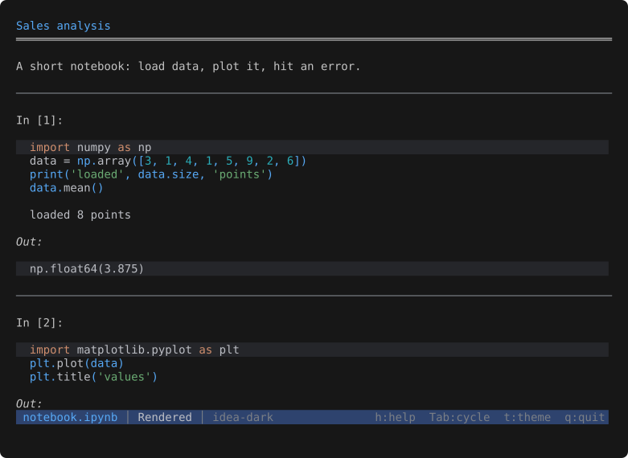

# Jupyter notebooks

An `.ipynb` file is a JSON document made of cells. peek renders the cells instead of showing the raw
JSON. Like Markdown, a notebook has more than one view:

- **Rendered** is the default view. peek translates the notebook into a single Markdown document and
  renders it the same way as a Markdown file.
  - **Markdown cells** render as prose, with headings, lists, emphasis, tables, and so on.
  - **Code cells** show an `In [n]:` label and the source as a fenced block. peek highlights the
    source in the kernel language.
  - **Outputs** appear under each code cell:
    - `stdout` and `stderr` streams and `text/plain` results show as fenced text.
    - An `error` output shows as a bold `ename: evalue` line, followed by the traceback. peek strips
      the ANSI color codes from the traceback.
    - An image output shows by name only. The name matches the one in the Blocks view, for example
      `image-1.png`.

  <!-- peek-skip -->

  

  _The rendered view shows Markdown prose, an `In [n]:` code cell highlighted in the kernel
  language, and the cell's output below it._

  <!-- /peek-skip -->

- **Source** shows the raw notebook JSON, pretty-printed in the same view as other structured data.
  To reach it, press `Tab`. To toggle the raw, unformatted JSON, press `r`. To open the notebook in
  this view, use `--raw`.
- **Blocks** is a flat table of contents. It lists every code cell and image output in order, with
  readable names such as `code-1.py` and `image-1.png` instead of the notebook's opaque cell IDs. In
  this view, you can do the following:
  - To extract the selected block, press `e`. A code cell saves as its source, as a `.py` file or
    the kernel language's file type. An image saves as the decoded `.png`, `.jpg`, or `.svg` file.
    This does the same as `peek --extract code-1.py notebook.ipynb`.
  - To open the block, press `Enter`. peek opens an in-memory copy of it. Code opens with syntax
    highlighting, and images render as ASCII art. To return to the notebook, press `Esc`.
  - To print the block names and sizes to stdout, run `peek --list notebook.ipynb`.

To turn off the rendered view, use `--plain`.

peek parses both nbformat 4 and the older `worksheets` layout of nbformat 3.

> The rendered view shows image outputs by name (`🖼 image-1.png`) and doesn't draw them inline.
> Drawing them inside the scrolling text is a planned addition. To see an image now, open the
> **Blocks** view, select the image, and press `Enter`.

The Info view adds a Notebook section with these fields:

- The nbformat version
- The kernel's display name and language, plus the language version
- The cell count, split into code, Markdown, and raw cells
- The output count, with image outputs and errors also counted on their own
- The highest execution count
