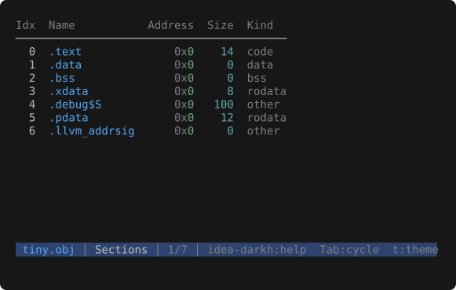
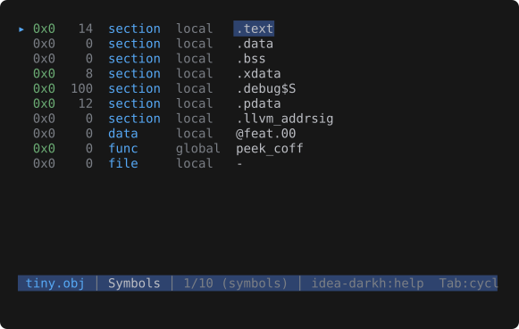

# Object files

peek opens executables, shared libraries, relocatable objects, and **WebAssembly** modules in a
dedicated viewer instead of the binary hex fallback. It supports **ELF**, **Mach-O**, **PE** and
**COFF**, and **`.wasm`**. peek detects these formats by their magic bytes, so it recognizes a
binary without an extension, such as `/bin/ls`. It doesn't need a `.elf` or `.exe` extension.
WebAssembly functions show up in the Symbols view.

## Views

To switch between the three views, press `Tab`:

- **Info** shows a summary of the header. This includes the format, the architecture, and the kind
  of file, such as an executable, relocatable object, dynamic library, or core dump. It also shows
  whether the file is 32-bit or 64-bit, the endianness, the entry point, the number of sections and
  symbols, and whether the file has debug info. It shows the build identity, which is the ELF build
  ID, the Mach-O UUID, or the PE PDB GUID. If the file links against shared libraries, the view
  lists them. These come from the ELF `DT_NEEDED` entries, the Mach-O dylibs, or the PE imports.
- **Sections** is a table of every section, with its index, name, address, size, and kind.
- **Symbols** lists every symbol, with its address, size, type, bind, and name. To jump the **Hex**
  view straight to the byte offset of the selected symbol, press `Enter`. This takes you from a name
  to its bytes in one keystroke, and peek highlights the byte where you land. Some symbols have no
  location in the file, such as undefined imports or `.bss` data. These show a muted address and
  don't jump. If the file is stripped, the view shows the dynamic symbol table in place of the
  missing `.symtab`.

## Navigating sections and symbols

- The **Sections** table keeps its column header pinned at the top while the body scrolls. Each
  column is as wide as its content.
- To pan either view, press `Left` and `Right`. Symbol names are often wider than the terminal.
- To search names, press `/`. To step through matches, press `n` and `p`. peek scrolls or pans only
  as far as it needs to bring each match on screen.
- To change the theme, press `t`. Both views change color in place.

## Universal Mach-O files

A universal Mach-O file, also called a fat binary, holds slices for several architectures in one
file. peek parses the slice that matches your machine and lists every slice in the Info view.

Bare COFF `.obj` files have no dedicated magic bytes, so peek recognizes them by checking the COFF
header. A Wavefront `.obj` 3D model uses the same extension but is text, and it still opens as text.

## Limitations

Sections and symbols are views, not files you can extract. The `e` key doesn't extract anything
here. On a symbol row, `Enter` jumps within the file instead of opening anything.

`peek --list` on an object file prints the symbol table as a readable dump in the style of `nm`. The
dump shows the address, size, type, bind, and name of each symbol. This is useful on stdout, but the
dump has no extract keys that you can pass to `--extract`.
