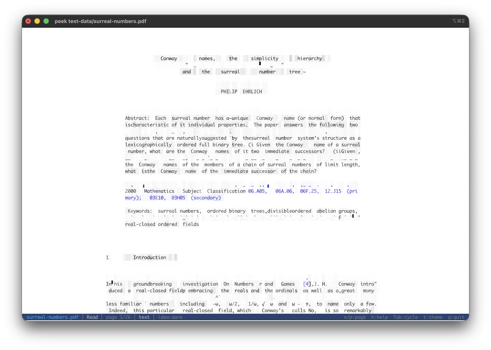

# PDF and Adobe Illustrator

peek opens `.pdf` files with [Pdfium](https://pdfium.googlesource.com/pdfium/), the PDF library from
Google. peek loads Pdfium at run time from the `libpdfium.*` file that ships with peek, so you don't
need to install it on your system.

`.ai` files from Adobe Illustrator 2005 and later are PDF documents inside, so they open in the same
modes. The only difference is that the Info section labels them as `Adobe Illustrator`. peek doesn't
support older Illustrator files that contain only PostScript.

A few `.ai` files keep their artwork only in private Illustrator data, behind a blank visible PDF
page. These files render empty in peek. Preview and Quick Look also show them blank.

## Modes

To cycle through the modes, press Tab.

### Read

**Read** is the default mode. It shows a paged image render. peek rasterizes each page with Pdfium
and renders it as ASCII through the shared image pipeline.

- To step to the next or previous page, press `n` or `p`. The status line shows `page X/Y`.
- To zoom and pan, use the standard keys. For details, see [Zoom and pan](../viewer/zoom-pan.md).

peek caches each rendered page by terminal size and render settings. When you resize the terminal or
cycle the image mode, peek renders only the visible page again.

To turn the **reconstructed-text overlay** on or off, press `o`. The overlay writes the real words
from the PDF's text layer over the rendered glyph cells, at their positions on the page. When you
zoom in until each text line takes about one terminal row, the blurred pixels turn into readable
sentences. For a typical A4 page at full terminal width, this happens at about 2× zoom.

- peek centers each word in its rendered box and crops the word to fit.
- When you zoom far past 1:1, the word floats inside its rendered letters, which are now large,
  instead of covering them.
- peek doesn't overlay words that render much smaller than a terminal cell. To see them, zoom in
  until the lines stop colliding.

While the overlay is on, the status line shows `text`. peek offers the overlay only when the
document has a text layer.

<!-- peek-skip -->

_The Read view with the reconstructed-text overlay (`o`). The rasterized page cells are underneath,
and the PDF's own words are written over them at their page positions._

<!-- /peek-skip -->

### Text

**Text** shows the text of the whole document, wrapped to the terminal width. Muted `--- Page N ---`
markers separate the pages. This mode appears only when the document has a text layer. Scanned
documents that contain only images and outlined vector artwork (`.ai`) have no text layer, so peek
leaves out the tab instead of showing it empty.

### Embeds

**Embeds** lists every inner item that you can extract:

- Attachments in `/EmbeddedFiles`, listed as `attachments/<name>`.
- Inline image XObjects on each page, listed as `pages/page{N}/image{M}.{ext}`.

To extract the selected entry, press `Enter` or `e`. peek opens the extracted item from memory in a
new peek view. For example, an attached CSV file opens in a CSV view, and an inline image renders as
ASCII art. peek hides this mode when the PDF has no attachments and no inline images.

### Info

**Info** shows the PDF version, title, author, subject, keywords, description, creation date,
modification date, page count, attachment count, and inline image count. If the PDF is encrypted,
Info also shows an encrypted flag.

## Print mode and pipes

In print mode (`--print`), peek writes every page in order, with blank lines between pages.

When you pipe a PDF to peek, as in `cat file.pdf | peek`, peek detects the `%PDF-` magic bytes and
opens the PDF modes.

If a PDF is encrypted or protected by a password, peek doesn't crash. The Info section shows the
error from opening the file instead.
