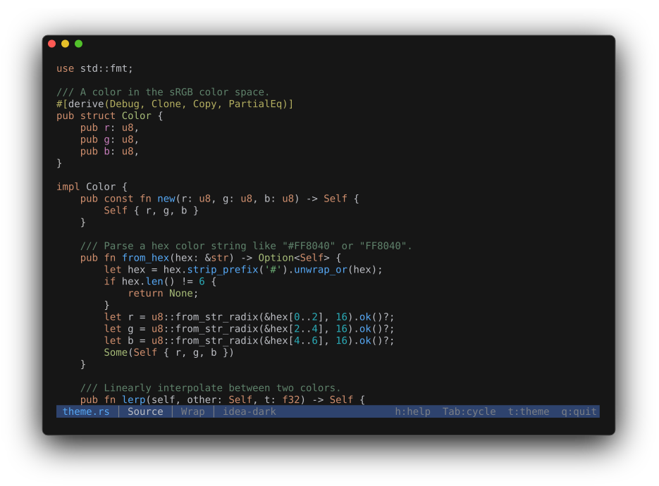

# Source code

peek shows source files as syntax-highlighted text. It uses
[syntect](https://github.com/trishume/syntect) with the extended grammars from
[two-face](https://github.com/Enselic/two-face), the same set that bat uses. These cover more than
100 languages, including Rust, Python, JavaScript, TypeScript, C, C++, Java, Go, Ruby, Shell, TOML,
and Dockerfile.



_When you open a recognized source file, peek highlights it automatically. The highlight colors
follow the active [color theme](../viewer/themes.md)._

If peek doesn't detect the language, set it with `-L`:

```sh
cat script | peek -L bash
peek -L rust unknown_file
```

## Config files

peek highlights config files the same way. These include `.ini`, `.cfg`, `.conf`, `.properties`,
`.env`, `.hcl`, and `.tf` files. peek also matches files by name, such as `Makefile`, `Dockerfile`,
`.gitignore`, and `.editorconfig`.

Some file names have a misleading extension or none at all. peek handles a few of these as special
cases:

- `.env.local`, `.env.production`, and `.envrc` highlight as `.env`.
- `justfile` uses the Makefile grammar.
- `.dockerignore` uses the gitignore grammar.

Formats without a grammar, such as `.dhall` and `.cue`, show as plain text.

## Line numbers

Line numbers are off by default. To turn them on at startup, use `-n` or `--line-numbers`. To toggle
them in the viewer, press `l`.

## Soft wrap

Soft wrap is on by default. To toggle it, press `w`. When wrap is off, `Left` and `Right` pan the
viewport horizontally, like `less -S`.

## SQL

peek shows `.sql`, `.ddl`, `.dml`, `.psql`, and `.pgsql` files as highlighted source. The Info view
adds an SQL section with these details:

- The dialect that peek guesses. It can be PostgreSQL, MySQL, SQLite, T-SQL, or generic.
- The number of statements in each category. The categories are DDL, DML, DQL, TCL, and Other.
- Lists of the objects that the file creates: tables, views, indexes, functions, and triggers.
- The number of comment lines.
- A flag that shows whether the file has an inline `$$ … $$` PL/pgSQL block.

## CSS

peek shows `.css` files as highlighted source. The Info view adds a CSS section with these details:

- The number of style rules, including nested rules.
- The number of selectors, with a histogram by kind: class, ID, element, pseudo, attribute, and
  universal.
- The number of custom properties.
- The number of `@media` and `@keyframes` rules.
- A list of `@import` rules, with external URLs flagged.

A Colors section shows the colors of the stylesheet as block swatches, with the most frequent color
first. peek doesn't count color words inside selectors, strings, or comments as colors.
