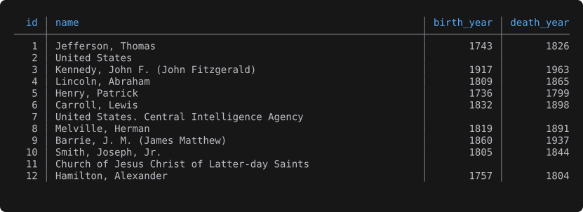

# SQLite databases

| Format   | Extensions                           |
| -------- | ------------------------------------ |
| SQLite 3 | `.sqlite`, `.sqlite3`, `.db`, `.db3` |

peek opens SQLite databases **read-only**. You can see the schema, the row counts, and the rows
themselves. peek never writes to the database. Every connection carries the `SQLITE_OPEN_READ_ONLY`
flag. peek has the SQLite library built in, so you don't need to install a system `libsqlite`.

## Landing view: the schema listing

When you open a database, peek shows a tree of every user-facing schema object, grouped by kind:

```text
tables/
  ├╴books.sql
  ├╴books.csv
  ├╴authors.sql
  ├╴authors.csv
  …
views/
  ├╴popular_authors.sql
  └╴popular_authors.csv
indexes/
  ├╴idx_books_language.sql
  …
triggers/
  …
```

Each table and view has two leaves:

- **`<name>.sql`**: the `CREATE …` statement that defines the entity.
- **`<name>.csv`**: the rows of the entity.

Indexes and triggers get only the `.sql` leaf, because they don't hold rows of their own.

peek leaves out empty groups. For example, a database without triggers has no `triggers/` group.

For schema rows, the size column shows the length of the `CREATE` statement in bytes. For contents
rows, it shows the row count. This lets you compare the sizes of tables at a glance.

## Schema view (`<name>.sql`)

To see the `CREATE …` statement of an entity, select its schema leaf and press `Enter`. peek reads
the statement from `sqlite_master` and adds a `-- <name> from <db>` header comment. It then opens
the result as an in-memory `.sql` file in the standard SQL syntax-highlight view. To return to the
listing, press `Esc`.

To save a schema leaf to disk, press `e`, the same as for any archive entry.

You can also extract contents leaves (`<name>.csv`). Press `e`, or run
`peek --extract tables/books.csv library.sqlite`. peek streams `SELECT * FROM "<entity>"` through a
CSV writer into a temporary file and saves it where you choose in the prompt. Extracts map cells as
follows:

- `NULL` becomes an empty cell. This is the standard CSV convention, but it means you can't tell a
  `NULL` from an empty string.
- `INTEGER`, `REAL`, and `TEXT` values use their display form.
- `BLOB` values become an SQL hex literal such as `X'68656c6c6f'`. This is lossless, and you can use
  the value as is in an `INSERT` statement. The cost is size for large BLOB values.

## Contents view (`<name>.csv`)

To browse the rows of a table or view, select its contents leaf and press `Enter`. peek opens a
**streaming row view**:

<!-- peek-skip -->



_The rows of a table, drawn as an aligned table. The CSV viewer uses the same renderer, here fed by
a SQLite cursor. `NULL` cells show a muted `NULL`. The body scrolls a 1000-row sliding window, so
peek never loads the whole table._

<!-- /peek-skip -->

- A sticky header row shows the column names.
- peek fetches body rows lazily. It holds a sliding window of 1000 rows in memory. When you scroll
  outside the current window, peek refills the buffer with a new
  `SELECT * FROM "<entity>" LIMIT 1000 OFFSET k`.
- peek knows the total row count from the start, because it runs one `COUNT(*)` when it opens the
  view. When you press `G` or `End`, peek goes straight to the last row without paging through the
  whole table.
- To search cells, press `/`. To step through matches, press `n` and `p`.

Each column aligns by its declared type affinity. `INT`, `REAL`, `NUMERIC`, and `DECIMAL` columns
align right, so the digits line up. Text-like columns, such as `CHAR`, `TEXT`, `CLOB`, `DATE`,
`TIME`, and `BOOL`, align left.

To fit the column widths to the visible window, press `Shift+R`. This can also make columns
narrower. To show or hide the header row, press `Shift+H`. If the table is wider than the terminal,
press `Left` and `Right` to pan.

The contents view and the CSV viewer share the same renderer, `RowsTableMode`. The only difference
is that a SQLite cursor feeds the rows instead of a CSV reader.

### NULL and BLOB cells

- `NULL` cells show the text `NULL` in a muted color, so you can tell them apart from empty strings.
- `BLOB` cells show as `<blob: N bytes>`. peek doesn't preview the bytes in hex yet. To see the
  declared type of the column, open the schema view.

### Search limits

Cell search pages the 1000-row window through the whole table, so it finds matches beyond the rows
in the buffer. Each search reads at most 256 MB of cell text. If a search hits that limit, peek
marks the counts as partial, such as `12/3400+` or `no match (partial scan)`, and shows a warning.
Searching with `LIKE` and `GLOB` queries in the database is planned.

## Info section

To reach the Info view, press `Tab` to cycle the views. The Info view shows the following:

- File details: page size, page count, encoding, journal mode, schema version, user version, the
  `application_id` if it isn't zero, and the result of `PRAGMA integrity_check(1)`.
- Schema counts: tables, views, indexes if there are any, triggers if there are any, and the total
  number of rows across all tables.
- A "Biggest tables" block that lists up to five tables by row count.

## Databases from stdin

You can pipe a database into peek, for example `cat lib.sqlite | peek`. peek writes the bytes to a
temporary file and opens the connection on that file. peek deletes the temporary file when it exits.

## Limitations

- Cell search reads at most 256 MB of cell text per search. Beyond that, peek marks the counts as
  partial.
- peek doesn't read `WAL`, `-journal`, or `-shm` sidecar files.
- peek doesn't support databases encrypted with SQLCipher.
- peek doesn't have a prompt for custom queries such as `:SELECT …`.
