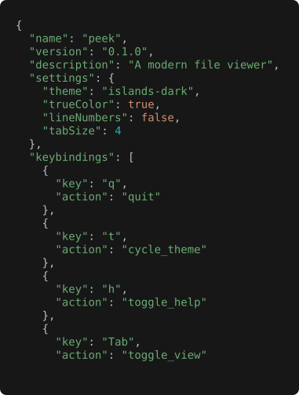

# Structured data

| Format     | Extensions          |
| ---------- | ------------------- |
| JSON       | `.json`, `.geojson` |
| JSONC      | `.jsonc`            |
| JSON5      | `.json5`            |
| JSON Lines | `.jsonl`, `.ndjson` |
| YAML       | `.yaml`, `.yml`     |
| TOML       | `.toml`             |
| XML        | `.xml`              |

## Pretty and raw views

Structured data has two views. To toggle between them, press `r`. To start in the raw view, use
`--raw` on the command line.

- **Pretty** shows the reformatted data, with syntax highlighting. This is the default for JSON,
  JSON Lines, YAML, TOML, and XML.
- **Raw** shows the source exactly as it's written. peek still highlights it, unless you set
  `--plain` or `-P`.

<!-- peek-skip -->

_Keys, strings, numbers, and Booleans each have their own color. The comments and the source
formatting stay intact, because JSONC defaults to the raw view instead of the pretty view._

<!-- /peek-skip -->

JSONC and JSON5 default to the **raw** view, because the pretty view drops comments and JSON5
syntax. To switch to the strict-JSON pretty view, press `r`.

In the pretty view of a JSON Lines file, peek passes each non-empty line through `serde_json` and
puts a blank line between the results.

## Info view

The Info view shows the top-level kind, the key or element count, the maximum nesting depth, and the
total node count. For XML, it also shows the root element name and the declared namespaces.
