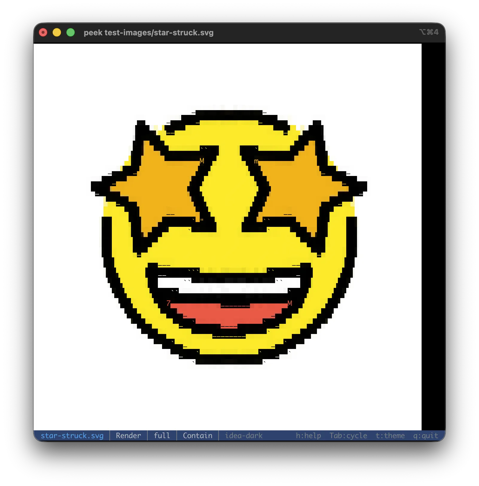

# SVG

SVG files (`.svg`) contain vector graphics. peek rasterizes them with
[resvg](https://github.com/RazrFalcon/resvg) and then renders the result as ASCII art.

SVG files have two view modes. To switch between them, press `Tab`:

- **Rendered preview** is the default. peek rasterizes the file and runs it through the image
  pipeline.
- **Source** shows the XML with syntax highlighting, either pretty-printed or raw.

When you resize the terminal, peek renders the image again.

## Animation

peek supports CSS `@keyframes` animation. The parser collects each `@keyframes` rule and the
`animation-*` properties in the inline styles of elements. From these, it builds one merged frame
timeline. With `steps()` timing, each stop is one frame. With `linear` timing, peek interpolates at
about 30 frames per second. peek rasterizes each frame when it needs it. A bounded cache keeps the
64 most recently used frames. For an animation with up to 64 frames, playback after the first loop
needs no new rasterizing.

The animation support covers what files from tools such as `termsvg` and `asciinema-svg` use:
`transform: translateX`, `translateY`, and `translate` with `steps()` or `linear` timing. peek finds
the target elements through inline `style="..."` attributes _or_ simple CSS selectors: tag,
`.class`, `#id`, and `tag.class`. peek silently ignores rules with combinators, pseudo-classes,
attribute selectors, or `*`. peek still doesn't support SMIL animation (`<animate>` and
`<animateMotion>`). To show the static image, use `--no-svg-anim`.

To play or pause the animation, press `Space`. To step through frames, press `n` and `p`. To extract
the current frame as a PNG, press `e`.

The Info panel shows the frame count, the total duration, and whether the animation loops or plays
once.

## Info view

The Info view shows the following:

- The `viewBox` and the declared dimensions.
- Element counts for paths, groups, rectangles, circles, and text.
- Flags for scripts and external `href` links.
- A summary of the animation.
- Statistics about the source text.
