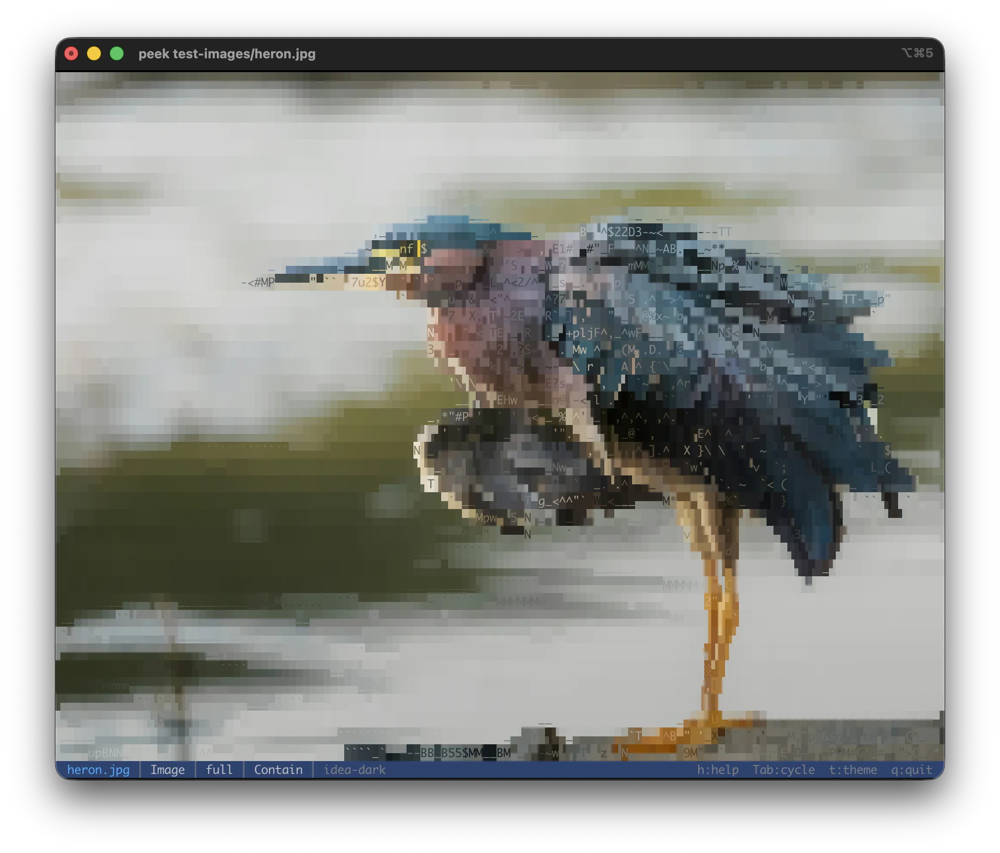

# Introduction

**peek** is a modern terminal file viewer. You can use it to preview any file in any format.

<!-- peek-skip -->

_peek renders a JPEG directly in the terminal. Each cell is a character whose shape and 24-bit color
approximate the pixels beneath it. To get this view, open any image file._

<!-- /peek-skip -->

<!-- peek:
Open any image file to see it rendered in the terminal: each cell is a character whose shape and
24-bit color approximate the pixels beneath it.
-->

Features at a glance:

- Syntax-highlighted source code in more than 100 languages.
- Markdown rendered with CommonMark and GitHub Flavored Markdown (GFM), including tables, task
  lists, footnotes, and front matter.
- Pretty-printed structured data in JSON, YAML, TOML, and XML.
- ASCII-art image rendering with 24-bit color.
- Playback of animated GIF, WebP, and SVG files.
- Office documents (DOCX, ODT, and RTF), PDF, Adobe Illustrator (`.ai`), and EPUB.
- Spreadsheets (`.xlsx`, `.xlsm`, and `.ods`). peek lists the sheets and shows each sheet as an
  aligned table.
- EPS and PostScript files (`.eps` and `.ps`). peek shows the embedded preview and can optionally
  render the file with Ghostscript.
- Audio metadata and embedded cover art.
- Archive browsing (ZIP, tar, 7-Zip, and cpio) and disk images (ISO and DMG).
- PEM certificates and keys, with subject, validity, subject alternative names (SANs), and
  fingerprints.
- A hex dump for unknown binary files.
- An interactive viewer with live theme cycling, file info, and extraction.

<!-- peek-skip -->

This manual is also built into peek. To read it in the terminal, run `peek --manual`. The built-in
copy matches the installed version. For details, see
[Help and about](./viewer/help-about.md#manual).

<!-- /peek-skip -->

## Design principles

**Single-file viewer.** peek opens one path, or stdin, at a time. It has no batch mode, no file
list, and no `cat`-style concatenation, because other tools cover those use cases. To view several
files, run peek once for each file.

**Stream, don't load.** peek handles multi-GB files as a first-class case. Archives open instantly
because peek walks only their headers. The hex dump reads from disk on demand. peek reads a whole
file only when the format needs it.

**Auto-detect.** peek detects binary content by its magic bytes and sniffs structured text on stdin.
The filename is a hint, not the source of truth.
