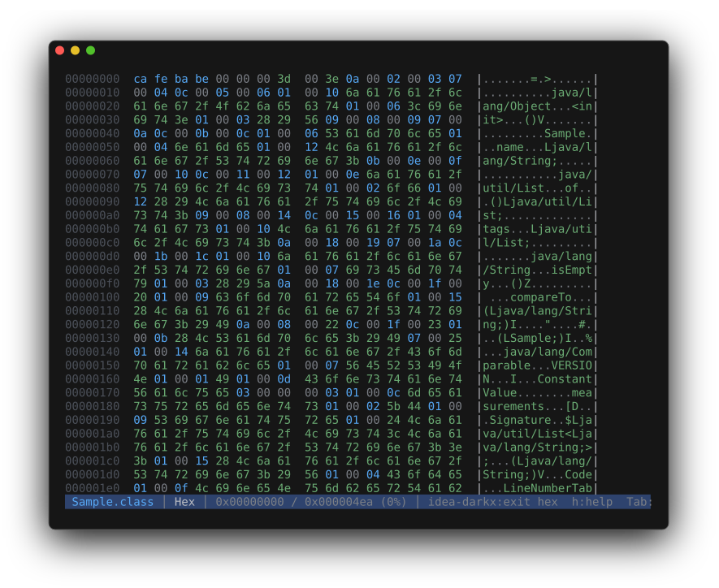

# Hex dump

To inspect the raw bytes of any file type, press `x` from any view. peek drops to a hex dump. To
return to the previous primary mode, press `x` again. When hex is the default view for a binary
file, there is no primary mode, so `x` does nothing there.

The layout follows `hexdump -C`:

- An 8-digit offset.
- Two hex columns of N/2 bytes each, with an extra space between them.
- A column of printable ASCII characters between `|` characters.

The number of bytes per row scales with the terminal width. A row takes `14 + 4*bpr` columns, where
`bpr` is the bytes per row. peek rounds `bpr` down to a multiple of 8, with a minimum of 8. In pipe
mode, peek uses `$COLUMNS` if it's at least 24. Otherwise, it uses 80 columns, which gives 16 bytes
per row.

The hex dump reads from disk on demand. It doesn't load the whole file, so multi-GB inputs are no
problem.

When you switch views, the viewer keeps a logical `Position`, which is a byte offset or a line
index. It saves the position when you leave a view and restores it when you return. If you enter hex
from a text view, the top row is at the byte offset of the current line. When you return to text,
the line scroll aligns to the hex position again.
