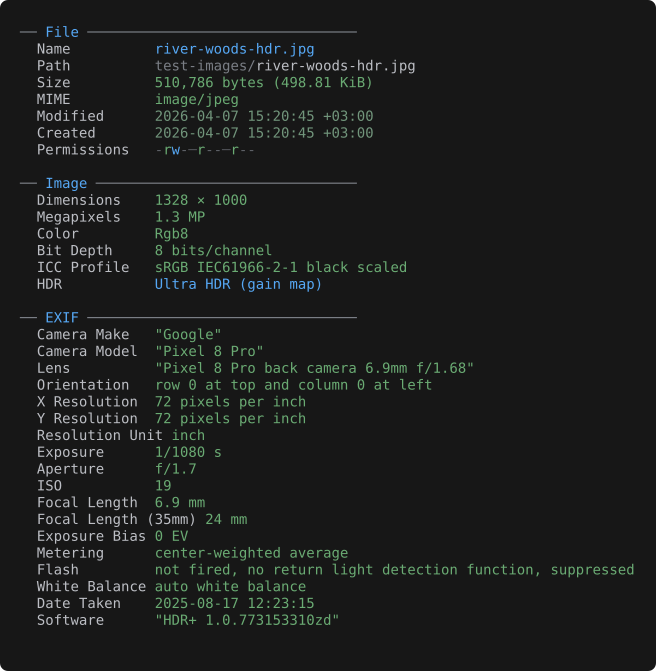

# File info

Every file type has an Info view. You can open it in three ways:

- To jump straight to the Info view, press **`i`** in the viewer.
- To reach it as one of the file's view modes, press **`Tab`** until Info comes up.
- To print the info and exit, run peek with **`--info`** on the command line.

<!-- peek-skip -->



_The Info view shows the universal fields first: name, size, MIME type, and timestamps. Sections for
the format follow. For this image, they show its dimensions, color model, and HDR gain map, plus the
camera, lens, and exposure metadata that peek reads straight from EXIF._

<!-- /peek-skip -->

<!-- peek:
To see the Info view in action, press `i` on a JPEG. It shows the universal
fields first: name, size, MIME type, and timestamps. Sections for the format
follow. For an image, they show its dimensions, color model, and HDR gain map,
plus the camera, lens, and exposure metadata that peek reads from EXIF.
-->

## Universal fields

- **File** shows the name, path, and size. The size shows both as an exact byte count and in
  human-readable form.
- **MIME** shows the MIME type, which peek detects from the file's magic bytes.
- **Permissions** shows the file permissions, with each character colored.
- **Timestamps** shows the created, modified, and accessed times, colored by age.

## Format-specific sections

| File kind             | The Info section adds                                                                                                                                            |
| --------------------- | ---------------------------------------------------------------------------------------------------------------------------------------------------------------- |
| Text and source code  | Line, word, and character counts, blank lines, longest line, line endings, indent style, encoding, shebang                                                       |
| Markdown              | Heading counts, fenced code blocks and their languages, links, images, tables, list items, task progress, reading time                                           |
| SQL                   | Dialect, statement counts by category, inventory of created objects, comment count, PL/pgSQL flag                                                                |
| CSS                   | Rule count, selector count and a histogram by kind, counts of `@media`, `@keyframes`, and custom properties, `@import` list, grid of color swatches              |
| Structured data       | Top-level kind, key or element count, maximum nesting depth, total node count                                                                                    |
| CSV and TSV           | Format, delimiter, encoding, header detection, type inference for each column, record count, count of malformed rows                                             |
| Spreadsheet           | Sheet count and names, title, author, subject, keywords, creation date, modification date                                                                        |
| SQLite                | Page size, page count, encoding, journal mode, schema and user versions, counts of tables, views, indexes, and triggers, total rows, largest tables              |
| XML and SVG           | Root element, namespaces, element counts                                                                                                                         |
| Notebook              | Format, kernel, language, cell counts (code, Markdown, and raw), counts of outputs, images, and errors, highest execution count                                  |
| Image                 | Dimensions, megapixels, color mode, bit depth, ICC profile, HDR, EXIF, XMP                                                                                       |
| Animation             | Frame count, total duration, average FPS, loop count                                                                                                             |
| Audio                 | Container, codec, channels, sample rate, bit depth, bitrate, duration, tag fields                                                                                |
| Document              | Title, author, subject, keywords, dates, counts of paragraphs, words, and images                                                                                 |
| Email                 | Message count, From, To, Cc, Subject, Date, Message-ID, attachment count                                                                                         |
| Calendar and contacts | iCalendar: name, counts of events and to-dos, date range, version, product. vCard: contact count, version                                                        |
| PDF                   | PDF version, metadata, page count, attachment count, count of inline images                                                                                      |
| EPUB                  | Dublin Core metadata, spine length                                                                                                                               |
| EPS and PostScript    | Title, creator, creation date, BoundingBox, language level, page count, preview, render                                                                          |
| Comic                 | Page count, total image bytes                                                                                                                                    |
| Archive               | Counts of entries, files, and directories, total uncompressed size                                                                                               |
| Directory             | Counts of entries, files, and subdirectories                                                                                                                     |
| ISO                   | Volume label, system ID, publisher, authoring app, the four timestamps from the Primary Volume Descriptor                                                        |
| DMG                   | UDIF version, image variant, sizes, whether a partition map is present, trailer flags                                                                            |
| Compressed wrapper    | Codec, compressed size, uncompressed size                                                                                                                        |
| Object files          | Format, architecture, type, class, endianness, entry point, counts of sections and symbols, debug info, build ID, linked libraries                               |
| Java classfile        | Class, superclass and interfaces, kind, class-file version, source file, field count, method count                                                               |
| Certificate           | For each entry: subject, issuer, serial, validity and days left, public key, signature, SANs, CA or self-signed, key usage, SHA-1 and SHA-256 fingerprints       |
| Font                  | Format, face count, family, subfamily, version, weight, width, style, glyph count, units per em, codepoint coverage, scripts, hinting, designer, vendor, license |
| Binary                | Format detected from magic bytes (Mach-O, ELF, PE, SQLite, …)                                                                                                    |

By default, timestamps show in local time with the UTC offset. To show them in UTC instead, use
`--utc`.

## JSON output

To get the info screen as a single JSON object instead of the themed view, run
`peek <file> --info --json`. The JSON output is for shell pipelines:

```sh
peek report.pdf --info --json | jq .size_bytes
```

The `--json` option requires `--info`.

The JSON output follows these rules:

- The core metadata is fully typed. `size_bytes` is a number, and each MIME entry carries a machine
  `category`.
- Timestamps are ISO-8601 strings in UTC. They don't depend on `--utc`.
- peek leaves out fields that have no value, such as the created time, compression, or warnings. It
  doesn't write them as null.
- The statistics for the format sit under a key for each type, such as `pdf`, `archive`, or `image`.
  They hold raw typed values, and enum fields use lowercase tokens.
- Dates for each type, such as `pdf.created`, an email's `date`, or a document's `created` and
  `modified`, use the same ISO-8601 UTC form as the core timestamps. This holds whatever form the
  source file stored them in.

The fields depend on the file type, but the overall shape stays the same:

```json
{
  "file_name": "surreal-numbers.pdf",
  "path": "test-data/surreal-numbers.pdf",
  "size_bytes": 575907,
  "mimes": [
    {
      "mime": "application/pdf",
      "category": "registered"
    }
  ],
  "modified": "2026-05-09T07:27:14Z",
  "created": "2026-05-09T07:27:14Z",
  "permissions": "-rw-r--r--",
  "pdf": {
    "flavor": "pdf",
    "pdf_version": "1.5",
    "encrypted": false,
    "created": "2011-01-25T13:32:43Z",
    "page_count": 26,
    "image_count": 1
  }
}
```
